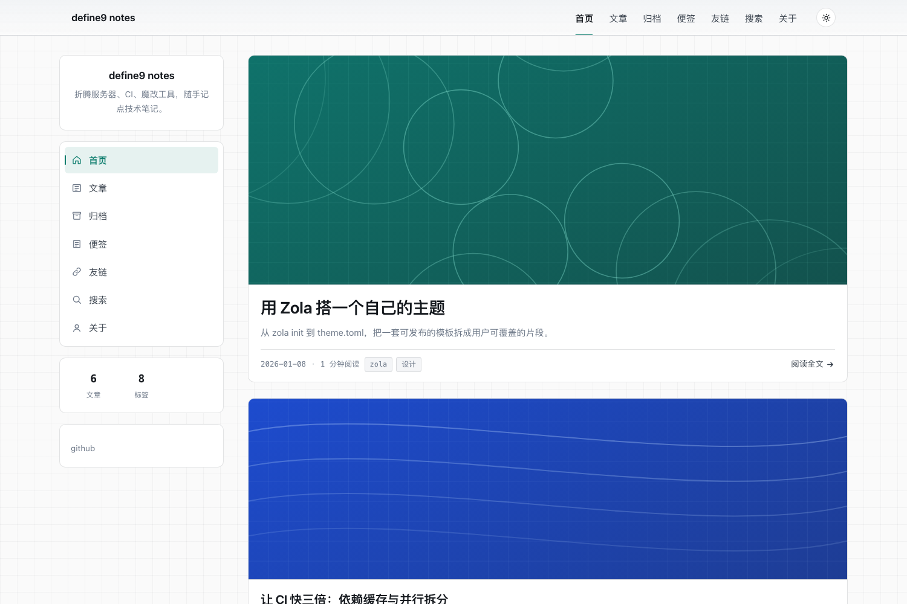
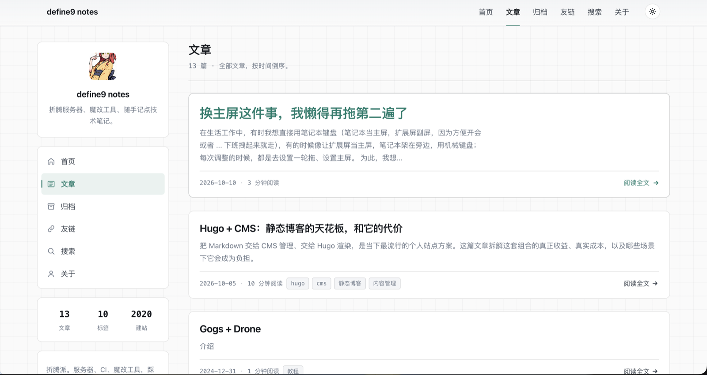

# Vellum

左栏 + 文章流的 Zola 博客主题：左边是站点卡 / 菜单 / 统计，右边是文章流；文章页是
「左栏 + 正文 + 右侧目录」三栏。界面文案中文，内置明暗切换、阅读进度、代码块复制、
目录滚动高亮、Pagefind 搜索、友链页、便签流与 giscus 评论。

- 主题：`theme.toml`
- 演示站：仓库根目录的 `zola.toml` + `content/`（`zola serve` 直接跑起来就是本站预览）
- 依赖：Zola **0.23+**（用到了 `paginator`、`get_taxonomy()`、frontmatter `[extra]` 等 0.23 API）

## 预览

首页：左栏 + 头条大卡 + 文章流。



文章列表：section 列表页，头条放大卡，其余小卡。



## 安装

```bash
git submodule add https://github.com/define9/zola-theme-vellum themes/vellum
```

在 `zola.toml` 顶部加（Zola 会自动补 `themes/` 前缀，所以写 `vellum` 而不是 `themes/vellum`）：

```toml
theme = "vellum"
compile_sass = true

# 正文里常有 ${{ ... }}（CI 配置）这类 Tera 语法，建议关掉正文模板化
skip_content_templating = ["**/*.md"]
```

搜索需要额外生成一次索引（见下文）。

## 功能

| 页面 | 模板 | 说明 |
| --- | --- | --- |
| 首页 | `index.html` | 头条大卡 + 文章流，取 `extra.default_section` 里最新的 N 篇 |
| 文章列表 | `section.html` | section 列表页；frontmatter 里加 `paginate_by = N` 启用分页（分页器是 `partials/pager.html`） |
| 文章 / 页面 | `page.html` | 正文 + 右侧目录、上下篇、评论；左栏由 `base.html` 统一提供 |
| 分类（标签） | `taxonomy_list.html` / `taxonomy_single.html` | 标签云与标签下的文章 |
| 归档 | `archive.html` | 按年份分组 |
| 便签 | `notes.html` | 时间线式短内容 |
| 友链 | `friends.html` | frontmatter 里的 `[[extra.friends]]` |
| 搜索 | `search.html` | Pagefind 静态索引 |
| 404 | `404.html` | — |

其它：明暗切换（记住偏好、默认跟随系统）、阅读进度条、代码块语言标签与一键复制、
目录滚动高亮、回到顶部、导航高亮（文章页也会点亮所属栏目）、外链自动 `target="_blank"`、
RSS / sitemap / robots.txt / SEO meta。

布局：`.shell` 是「左栏 + 内容」两列网格，左栏（`partials/sidebar.html`）依次是站点卡、
带图标的菜单卡、文章/标签/建站年份统计卡、作者简介与社交链接。窄屏（≤960px）侧栏变成
横向两栏，再窄（≤720px）只保留站点卡，其余折叠，菜单交给顶栏。

## 配置

站点级，全部写在 `zola.toml` 的 `[extra]`：

```toml
[extra]
default_section = "posts"   # 首页卡片取哪个 section，必须真实存在；留空则首页只留 hero
home_posts = 12              # 首页最多显示几篇
taxonomy = "tags"            # 分类名，默认 tags
home_title = "首页"
since = 2020
footer_license = "CC BY-NC-SA 4.0"
footer_note = "本站由 Vellum 驱动"
favicon = "/img/favicon.svg"
avatar = "/img/avatar.svg"

# 页脚社交链接，只有 http(s) 开头的才渲染
[extra.social]
github = "https://github.com/define9"

# giscus 评论：四个字段填齐即开启
[extra.giscus]
repo = "define9/define9.github.io"
repo_id = "R_kgDOU8dogA"
category = "General"
category_id = "DIC_kwDOU8dogM4DHiMa"
mapping = "pathname"
```

界面文案也在 `[extra]` 里，全部可覆盖：

```toml
[extra]
minutes = "分钟阅读"
toc_title = "目录"
tag_label = "标签"
search_placeholder = "搜索文章…"
# ... 见 theme.toml [extra]
```

### 导航

导航项写在 `static/data/nav.toml`，删条目即隐藏，不用改模板：

```toml
[[nav]]
title = "首页"
path = "/"

[[nav]]
title = "文章"
path = "/posts/"
```

### 搜索

```bash
zola build
pagefind --site public
```

**不要加 `--minify`**：Zola 的压缩器会去掉属性引号，Pagefind 解析不了。

### 正文 frontmatter

Zola 0.23 起，自定义字段要放进显式的 `[extra]` 表，标签放 `[taxonomies]`：

```toml
+++
title = "文章标题"
description = "列表页摘要"
date = 2026-01-08

[extra]
cover = "/img/covers/demo.svg"   # 封面；缺省不渲染图片区域
featured = true                   # 预留字段，首页头条取最新一篇
comments = false                  # 关掉这篇的评论
note = "侧栏补充说明"              # 渲染在目录下方

[taxonomies]
tags = ["zola", "设计"]
+++
```

封面图建议：**宽度 ≥ 1200px、比例 21:9（卡片区是 1040×300，首条 1040×380）、
单张 < 200KB**。卡片刻意裁得比较扁，竖图或窄图会被裁掉主体；分辨率不够时
浏览器要放大，会明显发糊。不想放图就别写 `cover`，紧凑文字卡是完整样式，不是降级。

### 便签与友链

便签 = 一个 section，frontmatter 里 `template = "notes.html"`。

```toml
+++
title = "便签"
template = "notes.html"
sort_by = "date"
+++
```

友链页 frontmatter：

```toml
+++
title = "友情链接"
template = "friends.html"

[[extra.friends]]
name = "站点名"
url = "https://example.com"
desc = "一句话介绍"
avatar = "/img/avatar.png"   # 可选
+++
```

### 中文 URL

中文标签默认会被 slugify 转成拼音，想保留中文：

```toml
[slugify]
taxonomies = "off"
```

## 目录结构

```
templates/            模板
templates/partials/   sidebar / header / footer / post-card / post-meta / toc / pager /
                      prev-next / comments / icon
sass/                 main.scss + 分片（改配色看 _tokens.scss）
static/               js / img / data/nav.toml
preview/              README 用的预览图
content/              演示内容
src/ + package.json   可选的 Tailwind v4 构建（默认不用）
theme.toml            主题元信息与默认配置
```

## 覆盖样式

Zola 编译站点自己的 `sass/main.scss`（同名文件会覆盖主题的）。想换配色，把主题的 sass
分片复制到自己站点里再改：

```bash
cp themes/vellum/sass/*.scss sass/
$EDITOR sass/_tokens.scss   # 改 --accent / --bg / 圆角等
```

只要改颜色的话，也可以不改主题文件，直接在页面底部追加一小段 CSS。

## 可选：Tailwind

主题默认样式是手写的 Sass（Zola 内置 sass 编译，零依赖）。想混用 utility class 时，
仓库里带了一套 Tailwind v4 配置，但**不装也不影响使用**：

```bash
npm install
npm run css          # 生成 static/tw.css
```

生成后在自己的站点 `templates/base.html` 里加
`<link rel="stylesheet" href="{{ get_url(path='tw.css') }}" />`。
`src/input.css` 里的 `@theme` 已经把主题的 CSS 变量接进 Tailwind（`bg-surface`、
`text-muted`、`font-mono` 等直接可用），换肤仍然只改 `sass/_tokens.scss`。

## 许可

MIT
